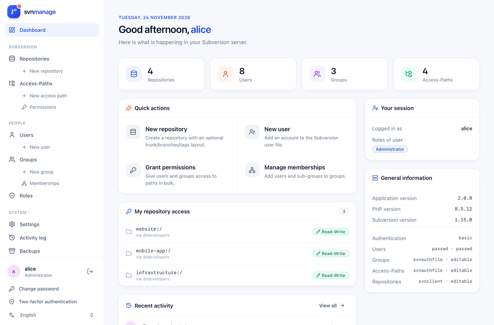
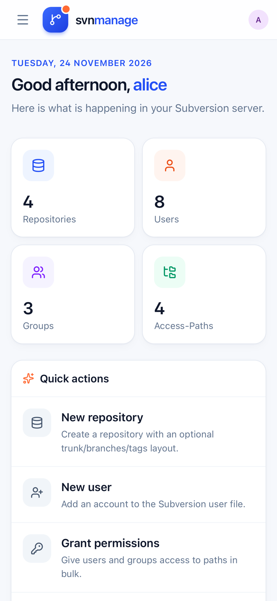
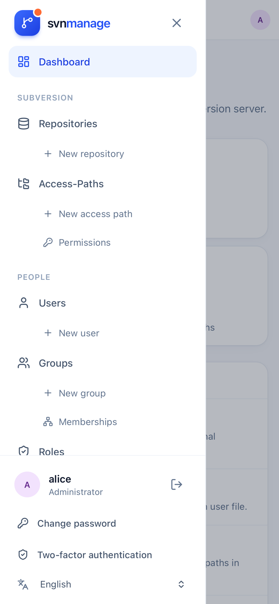
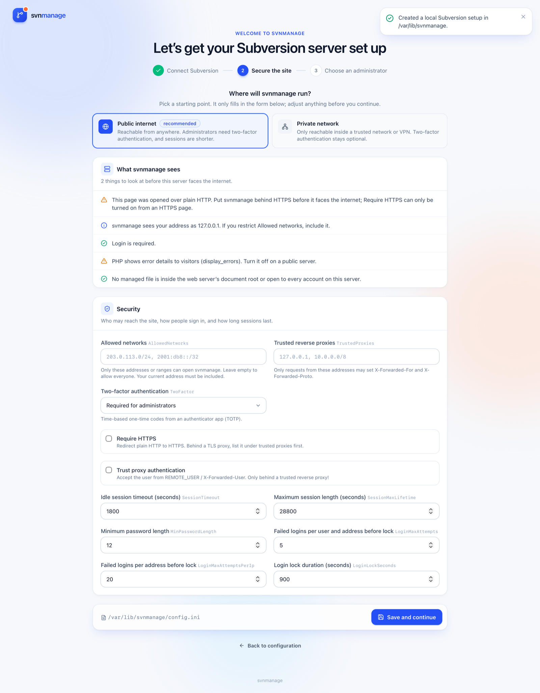
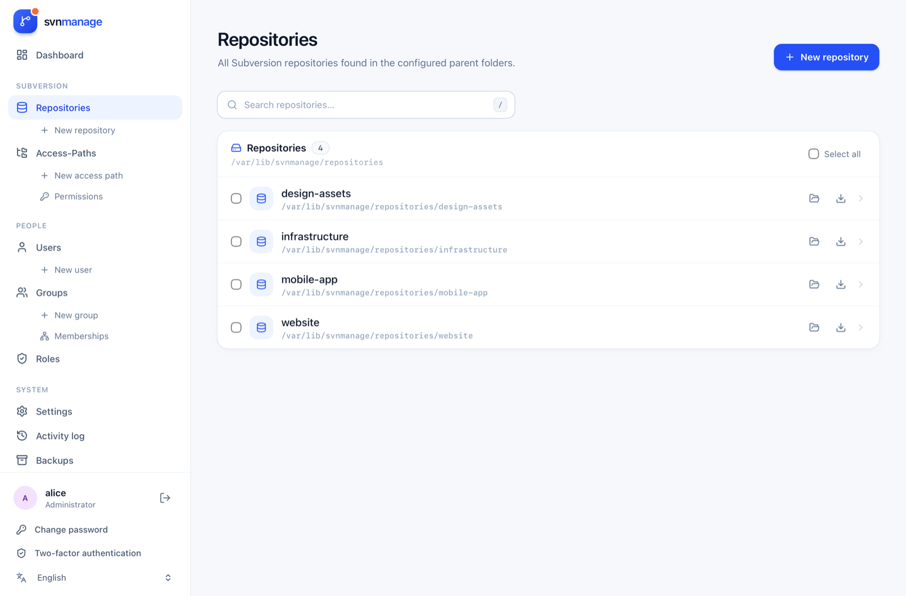
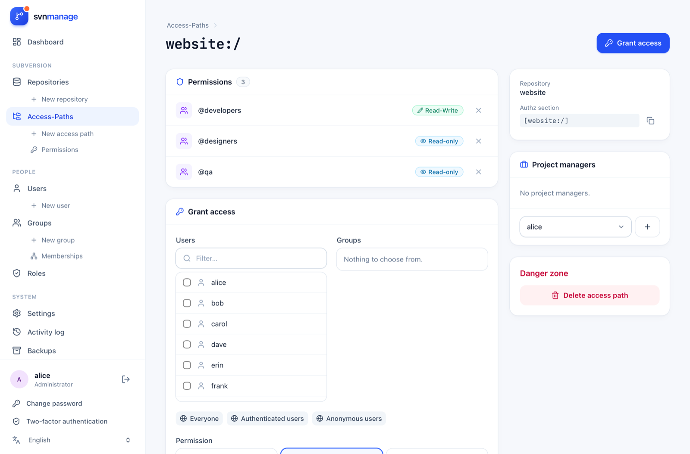
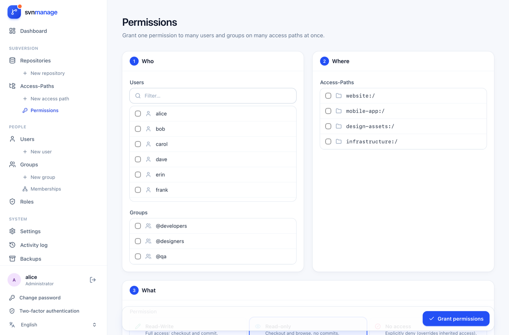
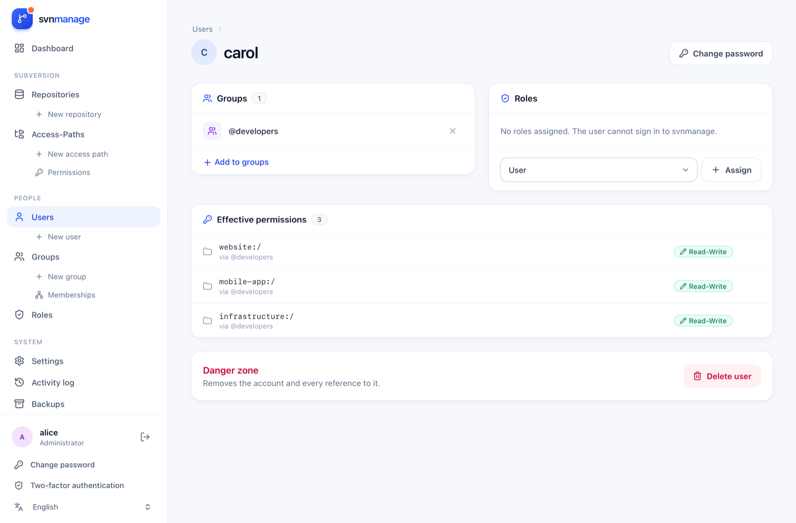

# svnmanage

A lightweight, modern web interface for administering a Subversion server — a ground-up
rewrite of [iF.SVNAdmin](https://github.com/mfreiholz/iF.SVNAdmin) on PHP 8, htmx and Tailwind CSS.

svnmanage edits the files your Subversion server already uses — the **authz** file, the
**htpasswd/htdigest** user file and the repository folders. There is no database and no
background daemon, and nothing to migrate away from: stop using svnmanage and your server keeps working.



<sub>Screenshots show a demo installation with made-up users and projects.</sub>

## Quick start

```bash
git clone https://github.com/gomoblaqo-faris/svnmanage.git
cd svnmanage
php -S localhost:8080 -t public public/index.php
```

Open <http://localhost:8080>, then:

1. Enter the setup key (print it with `bin/svnmanage setup-key`).
2. Click **Use local defaults** to create a test Subversion setup under `data/`.
3. Pick a security profile, then create your administrator account.

That's a working sandbox. For a real server, read [Install](#install) below.

## What it does

- **Repositories**: list several parent folders, create (FSFS/FSX/BDB, optional
  trunk/branches/tags or multi-project layout), browse, preview files, view the commit log,
  download dumps, load dumps, delete.
- **Users**: create, delete with full clean-up, change passwords (bcrypt, APR1 or SHA1),
  search, paginate and run bulk actions.
- **Groups**: nested groups, rename, bulk memberships, cycle detection.
- **Access paths and permissions**: grant Read-Write, Read-only or No access to users,
  groups, `*`, `$authenticated` and `$anonymous`, on one path or many at once.
- **Roles**: delegate administration (User-Group-Manager, Access-Path-Manager,
  Repository-Creator, …) and project managers scoped to their own access paths.
- **LDAP / Active Directory**: users and groups (nested AD groups included), a preview
  before synchronising, an optional cache, and a cron-friendly CLI.
- **Safety**: CSRF protection, a strict CSP, login rate limiting, hardened sessions,
  an automatic backup before every file change, and an activity (audit) log.
- **UI**: mobile-first with a sidebar on desktop and a drawer on phones, htmx-powered
  partial page updates, and 7 languages (en, de, es, ja, pt-BR, uk, zh-CN).

| Phone | Phone menu | Setup: secure the site |
|:---:|:---:|:---:|
|  |  |  |

The runtime needs **no Composer packages and no Node**: the built CSS, the htmx library and
the icon sprite are checked in under `public/assets/`.

## Requirements

- PHP **8.1+** (`ext-ldap` for LDAP/AD, `ext-mbstring` recommended)
- Subversion command-line tools (`svn`, `svnadmin`, `svnlook`) for repository features
- A web server that serves `public/` (Apache, nginx + PHP-FPM, Caddy, …)

## Install

```bash
git clone https://github.com/gomoblaqo-faris/svnmanage.git /var/www/svnmanage
cd /var/www/svnmanage
chown -R www-data:www-data data          # the web server must write data/
```

Nothing needs to be built: the CSS, JavaScript and icons are already in `public/assets/`.
To update later, `git pull` in the same folder; settings and state in `data/` are kept.

The web server user also needs write access to your authz file, user file and repository
parent folder(s).

Point the web server's document root at **`public/`**. Only that folder is served, so
`data/`, `src/` and the rest stay unreachable.

### Apache

```apache
<VirtualHost *:443>
    ServerName svn-admin.example.com
    DocumentRoot /var/www/svnmanage/public
    <Directory /var/www/svnmanage/public>
        AllowOverride All
        Require all granted
    </Directory>
</VirtualHost>
```

`public/.htaccess` routes every request to `index.php`. If you can only expose the whole
project folder, the root `.htaccess` forwards to `public/`, and `data/.htaccess` denies
access to `data/`.

### nginx

```nginx
server {
    server_name svn-admin.example.com;
    root /var/www/svnmanage/public;
    index index.php;

    location / { try_files $uri /index.php$is_args$args; }
    location ~ \.php$ {
        include fastcgi_params;
        fastcgi_param SCRIPT_FILENAME $document_root$fastcgi_script_name;
        fastcgi_pass unix:/run/php/php8.3-fpm.sock;
    }
    location ~* \.(css|js|svg)$ {
        expires 1y;
        add_header Cache-Control "public, immutable";
        add_header X-Content-Type-Options nosniff always;
        add_header Cross-Origin-Resource-Policy same-origin always;
    }
    location ~ /\. { deny all; }          # never serve dotfiles
}
```

PHP pages send their own security headers (CSP, HSTS over HTTPS, frame and referrer
policies); the static-file lines above cover the assets nginx serves directly.

### Try it locally

```bash
php -S localhost:8080 -t public public/index.php
```

## First run

Open the site to start the **setup wizard**. It first asks for a one-time **setup key**, which
proves you control the server: svnmanage writes it to `data/setup.key` (mode 0600), and
`bin/svnmanage setup-key` prints it. The key is deleted when setup finishes.

1. **Connect Subversion.** Point svnmanage at your existing authz file, user file and
   repository folder; use **Test** to check each path. Or click **Use local defaults** to
   create a fresh setup under `data/`.
2. **Secure the site.** Pick a starting point, **Public internet** (recommended: two-factor
   required for administrators, 30-minute idle timeout, 8-hour sessions) or **Private
   network** (two-factor optional, longer sessions), then adjust the security settings.
   This step also shows what svnmanage sees: whether the page arrived over HTTPS (or
   through a proxy it does not trust), your address as svnmanage sees it, whether
   `display_errors` is on, and any managed file inside the web server's document root or
   open to every account on the server. **Require HTTPS** is only proposed when this page
   itself is HTTPS, and the usual lock-out guards apply.
3. **Choose an administrator.** Promote an existing user, or create a new account with
   your own password. svnmanage never creates a default `admin/admin` account. The
   password rule from step 2 already applies, and if two-factor is required for
   administrators, the new administrator enrols right after signing in.

Change anything later under **Settings**. Settings are stored in `data/config.ini`.

Hook the files into Subversion as usual, for example:

```apache
<Location /svn>
    DAV svn
    SVNParentPath /var/svn
    AuthType Basic
    AuthName "Subversion"
    AuthUserFile /etc/subversion/passwd
    AuthzSVNAccessFile /etc/subversion/authz
    Require valid-user
</Location>
```

## Using svnmanage

Everything is reachable from the sidebar (a drawer on phones). A typical day:

**Add a person.** *Users → New user*: pick a user name and password (or let svnmanage
generate one). The account goes straight into the Subversion user file, so they can run
`svn checkout` right away. On their page you can change the password, add them to groups and
see every path they can reach and why ("via @developers").

**Organise people into groups.** *Groups → New group*, then *Memberships* to add many users
(or other groups) to many groups in one step. Grant access to groups rather than to
individuals and onboarding becomes "add to @developers".

**Create a repository.** *Repositories → New repository*: choose the standard
`trunk/branches/tags` layout, a multi-project layout or an empty repository, and tick
*Create access path* so it can be shared at once. Each repository page shows its size and
history, lets you browse folders and preview files, and (if enabled in *Settings*) download
or load a dump, or delete it.



**Decide who can read and write.** An *access path* is a repository folder such as
`website:/` or `website:/trunk`. Open one to grant **Read-Write**, **Read-only** or
**No access** to users, groups, everyone, signed-in users or anonymous users, or use
*Permissions* to grant one permission to many people on many paths at once. Rules on a
deeper path override the ones above it, exactly as in Subversion's authz file.





**Delegate.** *Roles* lets other people help without full control: a User-Group-Manager
manages accounts and groups, an Access-Path-Manager manages permissions, and a *project
manager* of an access path can manage permissions inside that path only.



**Look back.** *Activity log* lists every change and sign-in with who, what and from where.
*Backups* keeps a copy of the authz, user, role and config files from before each change,
ready to download.

**Your own account.** At the bottom of the sidebar: change your password, set up
two-factor authentication, switch language and sign out.

## Migrating from iF.SVNAdmin

svnmanage reads iF.SVNAdmin's configuration format and role file as-is:

```bash
cp /path/to/ifsvnadmin/data/config.ini              data/config.ini
cp /path/to/ifsvnadmin/data/userroleassignments.ini data/userroleassignments.ini
```

Every provider key in `[Engine:Providers]` and every path, LDAP and GUI setting keeps its
meaning. New optional keys (session timeout, password policy, login lock, backups, StartTLS,
LDAP cache, svnlook path) fall back to sensible defaults. Existing SHA1 and crypt passwords
keep working; new passwords use bcrypt unless you choose otherwise.

The rewrite also fixes several iF.SVNAdmin bugs:

- The `X-Forwarded-User` header was read from the wrong key.
- A project manager of `repo:/a` could manage `repo:/ab`.
- Nested groups were not resolved.
- LDAP filters were not escaped.
- An empty password could bind anonymously against LDAP.

The full list of changes is in [docs/PARITY.md](docs/PARITY.md).

## Command line

```text
bin/svnmanage update [--dry-run]   Synchronise LDAP/AD users and groups into the authz file
bin/svnmanage check [--docroot=<dir>]  Run every configuration test and the exposure checks
                                   (exits 1 on a failed test or a security warning)
bin/svnmanage set-admin <user>     Make <user> an Administrator (lock-out recovery)
bin/svnmanage passwd <user>        Set a password (prompt, or from STDIN)
bin/svnmanage setup-key            Print the key the setup wizard asks for
bin/svnmanage 2fa-reset <user>     Turn off two-factor authentication for <user> (lost phone)
bin/svnmanage version | license | help
```

To keep a directory-backed setup current, run the sync from cron:

```cron
*/15 * * * * www-data /var/www/svnmanage/bin/svnmanage update >/dev/null
```

Run the CLI as the web server user so file ownership stays consistent. Set `SVNMANAGE_DATA`
to use a data directory other than `./data`.

## Running on the public internet

svnmanage is built to be safe to expose, but the server around it matters too. Work
through this list before opening it up:

1. **HTTPS only.** Terminate TLS in the web server or a reverse proxy and turn on
   **Settings → Security → Require HTTPS** (`ForceHttps`). Over HTTPS the session cookie is
   named `__Host-svnmanage` (Secure, HttpOnly, SameSite=Lax, host-only) and HSTS is sent.
2. **Behind a reverse proxy, list it** under **Trusted reverse proxies** (`TrustedProxies`,
   e.g. `10.0.0.5` or `10.0.0.0/24`). Only those addresses may set `X-Forwarded-For` and
   `X-Forwarded-Proto`; from anyone else the headers are ignored, so a client cannot fake
   its address to dodge the login throttle or the network allow-list.
   If Apache's `mod_remoteip` already resolves the visitor's address (for example
   `RemoteIPHeader CF-Connecting-IP` for a Cloudflare Tunnel), leave the list empty:
   svnmanage then sees the visitor, not the proxy, so it never trusts `X-Forwarded-Proto`.
   Tell PHP about HTTPS in the vhost instead, trusting only the local tunnel connection:
   `<If "%{HTTP:X-Forwarded-Proto} == 'https' && %{CONN_REMOTE_ADDR} == '127.0.0.1'">SetEnv HTTPS on</If>`.
   svnmanage refuses to switch **Require HTTPS** on from a request it does not see as HTTPS,
   and if a proxy it does not trust reports HTTPS, it shows an explanation instead of looping.
3. **Turn on two-factor authentication** (`TwoFactor`): `optional` lets each user enrol
   under *Two-factor authentication* in the sidebar (their password is asked again); `admins` or `all` makes it mandatory:
   those users can reach nothing but the enrolment page until they have set it up. Codes
   are standard TOTP (any authenticator app), single-use, with 10 one-time recovery codes.
   An administrator can reset a user who lost their phone from the user's page, and
   `bin/svnmanage 2fa-reset <user>` recovers a locked-out administrator.
4. **Restrict who can reach it** with **Allowed networks** (`AllowedNetworks`) if your
   admins work from known addresses or a VPN. Other clients get a bare 403 before any
   session or login form. The setting refuses a list that would exclude your own address.
5. **Keep the data folder private.** Only `public/` should be the document root.
   Better still, move the data folder outside the web tree and point `SVNMANAGE_DATA` at
   it. Files there are created 0640/0600; keep it owned by the web server user.
   Keep the repositories, the authz file and the user file out of every document root
   too: a folder that serves a landing page must not also hold `repos/` or `.users`.
   Administrators see a warning on the dashboard when a managed file sits inside the
   document root or when a password file, the config or a key can be read by every
   account on the server (files svnmanage adopts keep the mode they had).
   `bin/svnmanage check --docroot=/path/to/docroot` runs the same checks from cron.
6. **Harden PHP**: `expose_php=Off`, `display_errors=Off`, `log_errors=On`,
   `session.use_strict_mode=1`, and keep PHP itself updated.
7. **Rate-limit at the proxy as well** (e.g. nginx `limit_req` on `/login`), as a first
   line in front of svnmanage's own throttles.

What svnmanage does on its own:

- **Setup is locked by a one-time key.** A fresh install asks for the key in
  `data/setup.key` (print it with `bin/svnmanage setup-key`), so nobody who merely finds a
  new installation can claim it. The key is deleted once the first administrator exists.
- **Login throttling** with three budgets per `LoginLockSeconds` window: per user and
  address (`LoginMaxAttempts`, default 5), per address (`LoginMaxAttemptsPerIp`, default
  20) and per account from any address (10 × `LoginMaxAttempts`), so neither a botnet nor
  IPv6 address rotation can guess one password without limit. IPv6 clients are counted by
  their /64 network. Each attempt is reserved *before* the password is checked, so parallel
  requests cannot slip past the limit; successful logins give their budget back. The same
  mechanism covers two-factor codes, the setup key and current-password checks. Unknown
  user names take as long to reject as wrong passwords, so names cannot be probed by timing.
- **Sessions** end after `SessionTimeout` idle seconds (default 3600) and after
  `SessionMaxLifetime` seconds in total (default 12 hours). Changing a password, enabling
  two-factor or resetting it ends that user's other sessions. Anonymous visitors get no
  session cookie at all, except on the login and setup pages.
- **Passwords** need `MinPasswordLength` characters (default 12) and are hashed with
  bcrypt. Very long inputs are refused before hashing.
- **Every form is CSRF-protected**, including the repository dump (a POST). The token
  rotates at login.
- **Headers**: a strict Content-Security-Policy (no inline script, `frame-ancestors 'none'`,
  `base-uri 'none'`), `X-Frame-Options: DENY`, `Referrer-Policy: no-referrer`,
  `Cross-Origin-Opener/Resource-Policy: same-origin`, `Cache-Control: no-store`, and no
  `X-Powered-By`.
- **Settings cannot be turned into code execution**: the svn tool settings accept only
  `svn`, `svnadmin` or `svnlook` (by name or absolute path), and file settings refuse
  names the web server might execute (`.php`, `.phtml`, `.phar`, `.htaccess`, …).
- **Authentication off** (`AuthenticationStatus=off`) makes everyone an administrator, so
  it only works for requests from the server itself (127.0.0.1/::1, with no forwarded
  headers from an unlisted proxy) unless you set `SVNMANAGE_ALLOW_NOAUTH=1`. It cannot be
  switched off from a remote browser, and any value other than exactly `off` keeps login
  on, so a typo fails closed.
- **Proxy authentication** (`HttpProxyAuth`) accepts `REMOTE_USER` from the web server,
  and `X-Forwarded-User` only from a trusted proxy. Proxy users still need a role that
  grants *login*. Users enrolled in two-factor authentication still enter their code:
  the proxy only replaces the password step.
- **Delegated administration is contained.** Only Administrators can change, reset or
  delete an Administrator's account. Project managers see only the repositories and
  folders inside the paths they manage (the repository-wide commit log is hidden from
  them), and reading file contents needs the *dump* right.
- **Error details** (file paths, `svn` output, LDAP DNs) are shown only to Administrators;
  everyone else gets a generic message and the details go to the PHP error log.
- **Backups.** Every write to the authz, user, role and config files first saves a
  timestamped backup to `data/backup/` (at least one is always kept; default 30).
- **Audit log.** Every change, sign-in and failed sign-in goes to `data/audit.log` (JSON
  lines, control characters stripped, rotated at 5 MB with 5 generations) and is shown
  under **Activity log**.

- **The login page needs no session.** Its CSRF token is signed with a per-installation
  key (`data/app.key`) and bound to a short-lived `SameSite=Strict` cookie, so anonymous
  visitors create no session files. A session starts only for a correctly signed login.
- **Wrong two-factor codes are reported.** The user is warned at their next sign-in, and
  administrators see a dashboard alert for 24 hours: only someone who already has the
  password reaches the code step. Recovery codes (80 bits, unguessable) are limited only
  per address, never per account, so nobody elsewhere can lock the real user out.

### Protecting Subversion access itself

Two-factor authentication protects this web interface. Subversion clients (`svn` over
HTTP or svnserve) have no second-factor step in their protocol, so they check only the
password file. On a public server, limit the repository endpoint to your networks or VPN
in Apache as well, for example:

```apache
<Location /svn>
    DAV svn
    SVNParentPath /var/svn
    AuthType Basic
    AuthName "Subversion"
    AuthUserFile /etc/subversion/passwd
    AuthzSVNAccessFile /etc/subversion/authz
    <RequireAll>
        Require valid-user
        Require ip 203.0.113.0/24 10.8.0.0/16   # office + VPN
    </RequireAll>
</Location>
```

Client certificates (`SSLVerifyClient require`) are an even stronger second factor for
`svn` if your users can install them.

## Development

```bash
composer install          # PHPUnit only
npm install               # Tailwind CLI, lucide-static, htmx
npm run build:css         # or: npm run watch:css
php scripts/build-icons.php
composer test             # unit + integration (real svnadmin) + HTTP tests
composer strings          # translation coverage per locale
```

```text
public/        index.php, .htaccess, built assets (app.css, app.js, htmx, icons.svg)
src/           App kernel, Http, Controllers, Authz, Users, Acl, Svn, Directory, Config, Cli
templates/     plain-PHP views (layout, partials, one folder per module)
lang/          translation catalogs (English source text → translation)
resources/     Tailwind entry point, config template
tests/         Unit, Integration (svnadmin), Http (in-process kernel)
```

To add a UI string, write it in English inside `t('…')`, then run `composer strings`, which
lists the strings each catalog is missing.

End-to-end: `tests/e2e/capabilities.cjs` drives a fresh install through every capability
in a real browser at phone (390 px) and desktop (1366 px) size: setup, settings, users,
groups and memberships, repositories (create, browse, dump, load, delete), access paths,
permissions, project managers, roles, passwords, two-factor sign-in, activity log,
backups, language and logout. It saves a screenshot per step (usage at the top of the file).

Real Safari: `tests/e2e/safari/runner.js` runs the same walk inside Safari (or Safari
Technology Preview) through any driver that can evaluate JavaScript in the page, such as
the Safari MCP. Serve the app with the test router so the runner loads under the page's
`script-src 'self'` policy:
`SVNMANAGE_DATA=<fresh dir> php -S 127.0.0.1:8096 -t public tests/e2e/safari/router.php`.
Then call this repeatedly, taking a full-page screenshot whenever it returns `shot`,
until it returns `done`. It returns `viewport` when it is time to switch to desktop size:
`if (!window.__L) await new Promise(r => { const s = document.createElement('script'); s.src = '/__qa/lib.js'; s.onload = r; document.head.append(s); }); return await window.__L.run();`
Every step ends its call before the page changes, because Safari's automation channel
drops the reply of a call that is still waiting when a page swap or load happens.


## License

GPL-2.0-only, the same license as iF.SVNAdmin. Icons: [Lucide](https://lucide.dev) (ISC).
htmx (0BSD).
